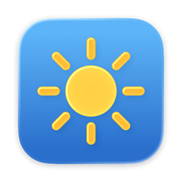
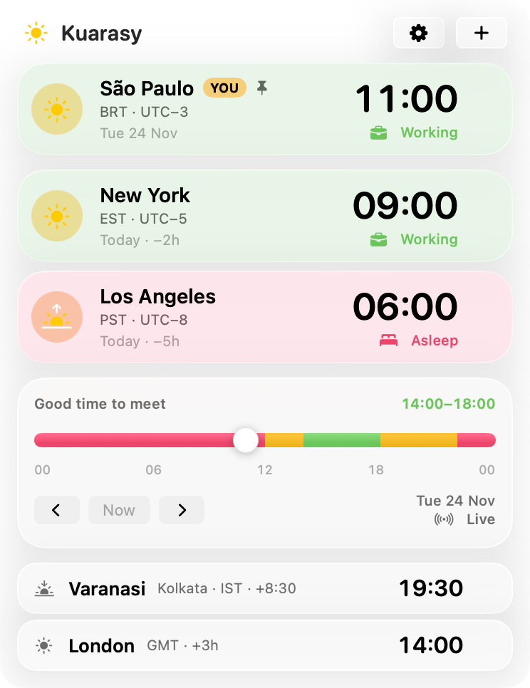
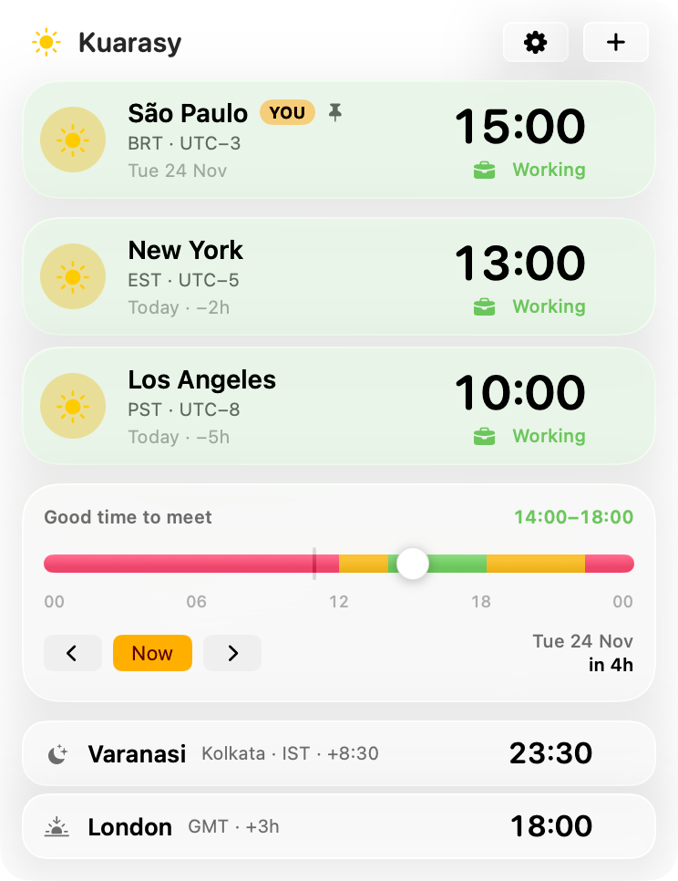

<p align="center">
  
</p>

<h1 align="center">Kuarasy</h1>

<p align="center">
  A small macOS menu bar app for working across time zones.<br>
  <em>Kuarasy</em> is the Tupi-Guarani word for the sun.
</p>

<p align="center">
  <a href="https://github.com/kauelima/kuarasy/releases/latest"><strong>Download the latest release</strong></a><br>
  macOS 14 or newer, Apple Silicon and Intel
</p>

<p align="center">
  <picture>
    <source media="(prefers-color-scheme: dark)" srcset="docs/screenshots/panel-dark.png">
    
  </picture>
  <picture>
    <source media="(prefers-color-scheme: dark)" srcset="docs/screenshots/scrub-dark.png">
    
  </picture>
</p>

It answers two questions:

1. **When is a good time to meet?** The bar across your day is green where everyone is in working hours, yellow where nobody is asleep, and red where someone is. At 11:00 in São Paulo (left), Los Angeles is still asleep, and the shared window is 14:00 to 18:00.
2. **What time is that for me?** Drag the bar until a coworker's row reads the time they mentioned ("11am EST"), and your row shows what that is for you. Dragged to 15:00 (right), it's 13:00 in New York and 10:00 in Los Angeles.

## Install

1. Download `Kuarasy-<version>.dmg` from the [latest release](https://github.com/kauelima/kuarasy/releases/latest).
2. Open it and drag **Kuarasy** into **Applications**.
3. Open Kuarasy. It lives in the menu bar (look for the sun) and has no Dock icon.

> [!NOTE]
> Kuarasy isn't signed with an Apple Developer ID, so macOS blocks it the first time. Try to open it once, then go to **System Settings > Privacy & Security** and click **Open Anyway** next to the Kuarasy message. macOS remembers the choice.
>
> Or remove the block from the terminal: `xattr -dr com.apple.quarantine /Applications/Kuarasy.app`

## Using it

- **Add a location** with **+**. Search by city, abbreviation (`EST`, `BRT`) or offset (`+5:30`), and give it a label such as "Design Team" if you like.
- **Rows above the bar** count toward it. **Rows below** are reference clocks: they follow the bar's time but don't change its colours. Drag rows to reorder them, or across the bar to switch sides.
- **Hover a row** for its **⋯** menu: show it in the menu bar, count it toward the bar or not, edit, remove.
- **Move through the day** by dragging the bar or with **‹ ›** (30 minutes at a time). **Now** goes back to the live time. The green range at the top right is today's longest shared working window: click it to jump there.
- **Settings** (the gear): your time zone, 12 or 24-hour time, open at login, what the menu bar shows, working days and hours, sleeping hours, and Quit.

## Contributing

Kuarasy was built to solve a problem of my own, and I already use it every day. Other people will have other needs, and that's where you come in: the best way to help is to join the [Discussions](https://github.com/kauelima/kuarasy/discussions). Ask for a feature, tell me how you'd use it, or talk about what it could do next.

Some ideas are already on the list in [FUTURE.md](FUTURE.md).

## Development

Building needs Xcode 26 or newer.

```sh
git clone https://github.com/kauelima/kuarasy.git
cd kuarasy
Scripts/run.sh
```

`Scripts/run.sh` builds a Debug copy and launches it, quitting any Kuarasy that's already running. You can also open `Kuarasy.xcodeproj` and press ⌘R.

Run the tests:

```sh
xcodebuild -project Kuarasy.xcodeproj -scheme Kuarasy -destination 'platform=macOS' test
```

### Install your own build

```sh
xcodebuild -project Kuarasy.xcodeproj -scheme Kuarasy -configuration Release \
  -derivedDataPath build -destination 'generic/platform=macOS' build
cp -R build/Build/Products/Release/Kuarasy.app /Applications/
```

This makes a universal app (Apple Silicon and Intel). Apps you build yourself aren't flagged as downloads, so it opens without the security prompt.

### Preview window

Debug builds accept `--preview <list|add|edit|settings>` to open the panel in a normal window, which is easier to inspect and screenshot than the menu bar popover. It opens on your sharpest screen, so screenshots come out at Retina resolution when one is attached. Optional flags:

- `--demo` uses sample locations and leaves your saved ones alone.
- `--now "2026-11-24 11:00"` fixes the clock at that time in your time zone, so screenshots can show a weekday on any day.
- `--scrub` moves the bar to 15:00 on that day.

```sh
Scripts/run.sh --preview list --demo --now "2026-11-24 11:00"
```

The screenshots in this README were taken this way, in Dark mode and again in Light mode (add `-NSRequiresAquaSystemAppearance YES` to force it), with the title bar cropped off.

### Releasing

Bump `MARKETING_VERSION` in the Xcode project, then build the disk image:

```sh
Scripts/make-dmg.sh
```

This makes a universal Release build and packages it as `dist/Kuarasy-<version>.dmg`, with the app on the left, an Applications shortcut on the right and a day-to-night sky behind them. Finder lays out the window, so the DMG window opens and closes on its own while the script runs, and the first run asks to let your terminal control Finder.

Publish it as a GitHub release (the script prints this command with the right version):

```sh
gh release create v0.1.0 dist/Kuarasy-0.1.0.dmg --title "Kuarasy 0.1.0"
```

The background is drawn by `Scripts/dmg/background.swift`. After changing it, run `swift Scripts/dmg/background.swift` to regenerate the images.

### Project layout

```
Kuarasy/
  KuarasyApp.swift        MenuBarExtra scene, app delegate, debug preview
  Models.swift            Location, WorkingHours, AppSettings, status enums
  ClockStore.swift        @Observable state, UserDefaults persistence, minute ticker
  TimeMath.swift          pure time calculations
  TimeZoneCatalog.swift   searchable zones and abbreviation map
  TimeFormat.swift        display formatting
  LaunchAtLogin.swift     SMAppService wrapper
  Views/                  SwiftUI panels and the glass helpers
  AppIcon.icon            app icon, editable in Icon Composer
KuarasyTests/             Swift Testing suites for TimeMath, the catalog and ClockStore
Scripts/
  run.sh                  Debug build and launch
  make-dmg.sh             Release build packaged as a DMG
  dmg/                    DMG window background and the script that draws it
docs/                     README icon and screenshots
```

The Xcode project uses synchronized folders, so any file added under `Kuarasy/` or `KuarasyTests/` is built automatically.

---

<p align="center"><sub>Kuarasy was developed by Kaue Lima (<a href="https://kauelima.com">kauelima.com</a>) with the aid of artificial intelligence.</sub></p>

<p align="center"><sub>It started as a replacement for <a href="https://hovrly.com/">Hovrly</a>, which I used before. Hovrly seems to have been abandoned for a while and had some recent commits I don't support, so I set out to modernize it and add the features it was missing for my own use.</sub></p>
